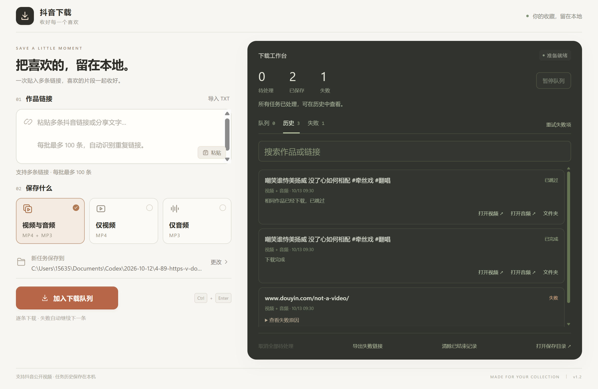

# 抖音下载桌面客户端

**Douyin Downloader Desktop** — 使用 Tauri + Rust 构建的 Windows 本地客户端。

粘贴抖音分享链接或整段分享文字，保存视频、MP3 音频，或两者一起保存。

[下载 Windows x64 EXE](https://github.com/roadto1e6/douyin-downloader-desktop/releases/download/v1.2.0/DouyinDownloader-Desktop-v1.2.0-windows-x64.exe) · [全部版本](https://github.com/roadto1e6/douyin-downloader-desktop/releases)



## 功能

- 支持抖音短链接和视频作品网页链接，也可以直接粘贴分享文字。
- 下载 MP4 视频、提取 MP3 音频，或同时保存两种文件。
- 暖白与墨色双栏界面，展示下载阶段、进度、完成结果和失败原因。
- 自选保存目录；同名文件自动编号，不覆盖已有文件。
- 批量粘贴分享文字、追加剪贴板内容，或导入 TXT；每批最多 100 条，未完成队列上限 100 条。
- 顺序下载，单条失败后继续；暂停/继续队列，单条取消、重试，批量取消和失败重试。
- 自动跳过相同链接；短链和长链解析为同一作品后也可去重（下载类型、保存目录相同且文件仍存在时）。
- 自动保存任务和历史记录，重启后点击继续恢复未完成任务；保留最近最多 500 条记录。
- 按标题或链接搜索历史，查看失败原因、导出失败链接，打开视频、音频及所属文件夹。
- 每条任务独立记住保存目录；清除历史只删除记录，不删除已下载文件。
- `Ctrl+Enter` 加入下载队列，`Esc` 取消当前正在下载的任务。
- 仅在用户点击“粘贴”时读取剪贴板。

## 直接运行

从 [Releases](https://github.com/roadto1e6/douyin-downloader-desktop/releases) 下载 EXE，双击运行。无需安装 Python、Node.js 或 Rust。

运行环境：

- Windows 10/11，64 位。
- 已安装 Google Chrome 或 Microsoft Edge，用于解析公开作品播放地址。
- Microsoft Edge WebView2 Runtime，用于显示桌面界面。如缺少，可从[微软官网](https://developer.microsoft.com/microsoft-edge/webview2/)安装。

音视频处理组件已内置，无需另行安装 FFmpeg。默认保存到当前用户的 `下载/抖音下载` 文件夹，可在界面中更改。

暂停队列会让当前任务完成后再暂停；要停止当前任务，请点击该任务的取消按钮。关闭应用会取消当前下载并保存待办队列。恢复时重新下载中断的任务，不支持按文件字节断点续传。历史记录保存在本机应用配置目录的 `queue-v2.json`；仅保留在历史中的完整文件参与去重。

## 支持范围

目前支持**公开可播放的抖音视频**。不支持直播、图集、私密或已删除作品，以及需要登录或验证后才能播放的作品。

视频清晰度由网页实际提供的播放版本决定；音频来自该视频的音轨，时长与作品一致。不会去除画面水印，也不会补成完整版歌曲。单个视频最大 1 GB。

工具直接访问抖音及对应媒体服务器，不使用第三方解析服务，不读取现有浏览器的登录资料。解析时使用临时浏览器目录，任务结束后清理。取消操作会等待当前网络操作返回，网络卡顿时可能需要稍候。

平台播放方式变化后，解析逻辑可能需要更新。

## 从源码构建

需要 Windows Rust/MSVC 工具链和 Visual Studio C++ Build Tools。前端为静态 HTML、CSS、JavaScript，无需 Node.js 构建步骤。

```powershell
git clone https://github.com/roadto1e6/douyin-downloader-desktop.git
cd douyin-downloader-desktop
cargo build --release --locked
```

生成文件：`target/release/douyin-downloader.exe`。

`assets/ffmpeg.exe.gz` 是构建所需的内置转换组件，会直接嵌入 EXE。运行时释放到临时目录，使用后清理。

```powershell
cargo test --release --locked
```

## 项目结构

| 路径 | 内容 |
| --- | --- |
| `src/main.rs` | Tauri 命令、文本导入导出、剪贴板和文件打开 |
| `src/queue.rs` | 队列调度、去重、历史持久化及恢复 |
| `src/download.rs` | 分享链接解析、浏览器通信、下载与音频转换 |
| `ui/` | 桌面界面 |
| `assets/` | 内置音视频转换组件 |
| `tauri.conf.json` | Tauri 窗口与安全策略配置 |

## 已完成验证

- 实际 Tauri 窗口中的链接校验、快捷键开始与取消。
- 真实抖音短链接下载 MP4 与 MP3，并完整解码检查两个文件。
- 标准窗口和最小窗口下的等待、下载中、完成、失败及取消状态。
- Rust 测试：链接域名校验、取消后的临时文件清理、重名文件保护、批量去重、队列容量、保存失败不入队、重启恢复、取消重试、退出和文本编码（共 11 项）。

## 许可证与组件

项目使用 [GPL-3.0-or-later](LICENSE)。第三方组件保留各自许可证，详见 [THIRD_PARTY_NOTICES.md](THIRD_PARTY_NOTICES.md)。
